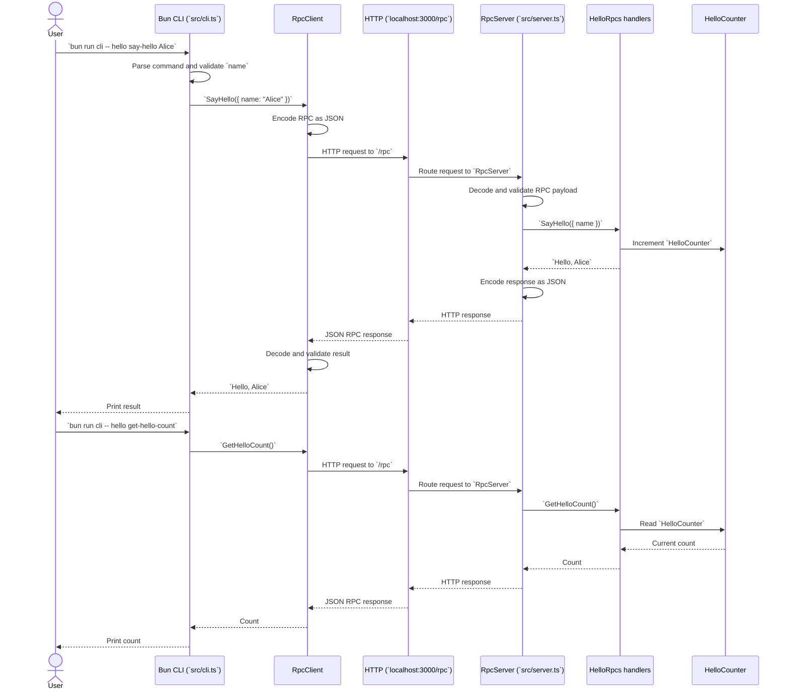

# CLI to Server Call Flow

Both CLI commands use the same RPC path. The shared contract is defined in
`src/api.ts` and is used to build the client and server handlers.

## Runtime Setup

- The server starts with `bun run server` and listens through `BunHttpServer`.
- The CLI creates an `RpcClient` pointed at `http://localhost:3000/rpc`.
- `RpcSerialization.layerJson` handles JSON encoding and decoding on both sides.
- OpenTelemetry layers create spans for CLI commands and server handlers and
  export them through OTLP when configured.
